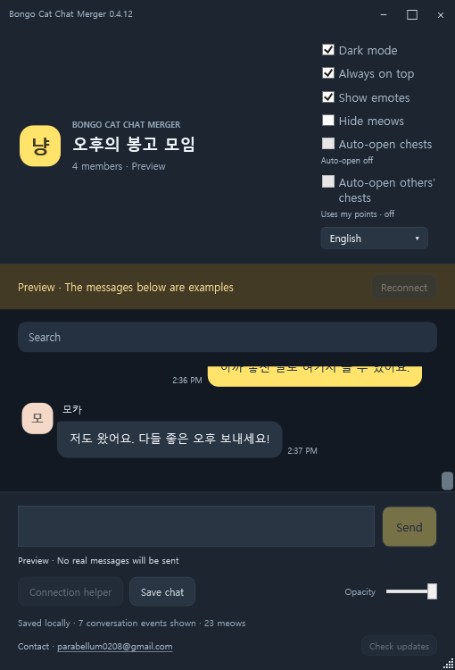

# Bongo Cat Chat Merger

**[Download for Windows](https://github.com/RATOY-Jeong/bongo-cat-chat-merger/releases/latest)** · **Version 0.4.12**

[한국어](README.md) · **English** · [日本語](README.ja.md)

A Windows chat companion for Steam Bongo Cat. Read the conversation in your room and send messages from a separate window.

## Get started

1. Download **BongoCatChatMerger-0.4.12.exe** from the link above and run it.
2. Choose your language on first launch. The app finds the game and prepares the connection files.
3. Click **Set up & restart game** when prompted. Windows requests permission if the game folder requires it.
4. Join a room in Bongo Cat. The companion connects automatically.

Use the desktop or Start menu shortcut next time. No ZIP extraction or separate install script is needed. The full ZIP in Releases includes source and runtime files.

**Requirements:** Windows 10/11 x64, .NET Framework 4.5+, Steam and Bongo Cat. The pen/touch compatibility setting requires .NET Framework 4.7+.

## Features

- Live room chat and direct sending: Enter sends, Shift+Enter adds a line
- Original emote images, exact-meow hiding and repeated-meow counts
- Dark mode, always-on-top, opacity, selectable and copyable text
- Name/message search and export: 500 ordinary events plus separate meow groups
- English, Korean and Japanese UI with saved settings
- Automatic connection setup/repair, reconnect and diagnostic copy
- Separate opt-ins for your own chests and other members' chests

Both chest options start off. **Opening other members' chests spends your own game points**, using the game's normal chest-gifting action. [Own chests](docs/AUTO-CHESTS.md) · [Other members' chests](docs/OTHER-CHESTS.md)

## Updates and connection

The app checks public GitHub releases once at startup or when you click **Check updates**. A newer release opens a download-page option; close the old app and run the new EXE. [Update details](docs/UPDATES.md)

0.4.12 fixes room-joining failures after a game update. The EXE includes bridge 0.2.5 and Json.NET 13.0.2. Use **Restore connection & restart game** for a paused connection, or **Set up & restart game** when an upgrade is needed. [Fix details](docs/RUNTIME-0.4.12.md)

Use **Reconnect** to retry a connection. To compare the game with the bridge disabled, right-click **Connection helper → Disable connection & restart game**. [Pen tablet notes](docs/TABLET-COMPATIBILITY.md)

## Records and settings

The app, settings and diagnostics are stored in `%LOCALAPPDATA%\BongoCatChatMerger`. Room journals are in the game folder at `BepInEx\BongoChat\room_<room ID>.jsonl`. Separate outgoing records in `own-sends` show received, waiting or rejected status.

Journals include room/Steam IDs, names, text and timestamps. Recording starts with messages received after installation, and the original journal stays on disk. The game bridge continues recording while the game runs, even when the chat window is closed. There is no separate chat server.

## Source and components

- [Architecture and build instructions](docs/ARCHITECTURE.md#english)
- [SHA-256 inventory: 133 release files and 39 embedded setup files](docs/RELEASE-FILES-0.4.12.json)
- [Source](src) · [Build/install/removal scripts](scripts) · [Check results](docs/VALIDATION.md)
- [Third-party components and licenses](licenses/THIRD-PARTY-NOTICES.md)

To remove the bridge, close the game and run `Uninstall.cmd` from the full ZIP. Journals and externally modified files are preserved.

Contact: [parabellum0208@gmail.com](mailto:parabellum0208@gmail.com)
