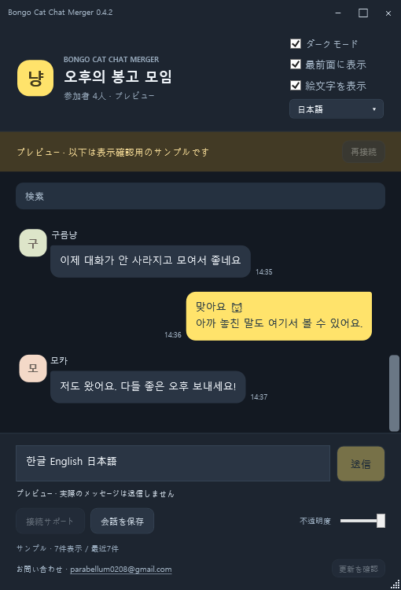

# Bongo Cat Chat Merger

## [⬇ 最新版をダウンロード — BongoCatChatMerger-0.4.7.exe](https://github.com/RATOY-Jeong/bongo-cat-chat-merger/releases/download/v0.4.7/BongoCatChatMerger-0.4.7.exe)

**EXEファイルをダウンロードして実行してください。ZIPの展開は不要です。**

[English](README.md) · [한국어](README.ko.md) · **日本語**

**0.4.7:** ゲームから応答した自分の送信文を **ゲーム処理済み · ルーム受信未確認** または **送信拒否 · このPCの記録** と表示し、一致する受信が届くと1件にまとめます。IME変換中は入力欄・会話の変更を延期し、遅い応答による下書きの復元と送信ボタンへのフォーカス移動を防ぎます。報告PCの入力切替問題は再確認が必要です。[詳細](docs/RELIABILITY-0.4.7.md)。

**公開アクセスのお知らせ(2026-10-29):** 設定はPublicですが、未ログインでアカウントと公開リポジトリが404になることを確認しました。ダウンロード・更新確認にも影響します。原因は未確定でGitHubサポートの確認が必要です。アプリはGitHubログインを要求・収集せず、所有者のログイン成功は公開アクセスの確認とは異なります。

Steam Bongo Catの同じルームの会話をまとめる軽量なWindows用アプリです。直接送信、ゲームの絵文字画像、ローカル記録・検索、英語・韓国語・日本語UIに対応しています。

## ダウンロードと起動 — 0.4.7

**[BongoCatChatMerger-0.4.7.exeをダウンロード](https://github.com/RATOY-Jeong/bongo-cat-chat-merger/releases/download/v0.4.7/BongoCatChatMerger-0.4.7.exe)** して実行してください。接続に必要なファイルは、このEXEにすべて含まれます。ZIPの展開、ゲームフォルダーの選択、Install.cmdの実行は不要です。

1. EXEを実行し、初回のみ言語を選択します。
2. ゲームの場所と接続ファイルを自動で準備します。必要な場合は **設定して再起動** を押してください。Windowsの許可画面が出た場合は、必要なファイルのインストールを許可してください。
3. Bongo Catが自動で起動したら、**参加したいルームを選択**します。アプリは自動で接続します。

次回からはデスクトップまたはスタートメニューの **Bongo Cat Chat Merger** ショートカットを使えます。Windows 10/11 x64と.NET Framework 4.5以降が必要です。SteamとBongo Catはインストール済みである必要があります。[Releases](https://github.com/RATOY-Jeong/bongo-cat-chat-merger/releases/latest)のZIPは任意の完全版・開発用パッケージです。Source codeのZIPは単体実行用アプリではありません。

## 自動接続の準備

- 別のSteamライブラリやカスタムのインストール先を検出し、接続ファイルを確認します。
- 不足ファイルのインストールと中断された設定の修復を行い、正常な既存環境はそのまま使います。
- 再起動ボタンはゲームに通常の終了を要求し、準備後に起動し直します。強制終了は行いません。終了できない場合はトレイメニューからの終了方法を案内します。
- ゲームフォルダーへの書き込みが拒否された場合のみ管理者権限を要求します。Windowsの許可画面とゲームのルーム選択は手動操作です。
- ゲーム本体のEXE・管理DLL、会話記録、互換性のあるユーザー設定を保持します。他のMODローダーや外部で変更されたファイルは上書きしません。
- **接続サポート**で再確認できます。右クリックで手動のゲーム選択と診断情報のコピーを使えます。
- ファイル設定の完了と接続成功を区別し、ゲームから新しい状態信号を受信してから接続済みと表示します。

## 更新と設定

以前のアプリを閉じて新しいEXEを実行してください。**更新は手動**です。サーバーから新しいプログラムを自動ダウンロード・実行する機能はありません。

GitHubの正式版情報を**アプリ起動時に1回**、または**更新を確認**ボタンを押したときだけ取得します。定期的な確認は行いません。新しいEXEが公開されると**新しいアップデートがあります！**と**ダウンロード**ボタンを表示します。ボタンはダウンロードリンクがある公開リポジトリのREADMEを開きます。ファイルのダウンロード・インストールは手動です。最近20件からEXEが準備された最大の正式バージョンを選び、Latest指定だけには依存しません。失敗時には最新単体リリースの経路でも1回確認します。起動時の結果・失敗・現在のバージョン・確認時刻を表示します。下書き・事前公開版は通知せず、接続失敗や回数制限でもチャットは続けられます。[更新確認の詳細](docs/UPDATES.md)。

本体、設定、診断ログは <code>%LOCALAPPDATA%\BongoCatChatMerger</code> に保存します。ダウンロードしたEXEと同じフォルダーの旧設定は、保存済みの選択を上書きせず一度だけ移行します。旧EXEが別のフォルダーにあった場合は言語・テーマの再選択が必要になることがありますが、ゲームフォルダーの会話記録は保持されます。

検証済みの接続プラグイン **0.2.2** と通信形式は変更していません。正常な既存環境は再インストール不要です。所有権記録を確認できるファイルのみ修復し、置換前のファイルをバックアップします。

## チャット機能

- 下部から直接送信できます。Enterで送信、Shift+Enterで改行し、IME変換中は確定を優先します。ゲーム本来のフィルターと送信処理を使います。
- ゲームの絵文字画像の表示切替、ダーク・ライト、最前面表示、不透明度、メッセージ・名前検索、現在のルームの通常会話500件と鳴き声のまとめ保存に対応します。
- 上部のドロップダウンでEnglish / 한국어 / 日本語を切り替えます。会話本文、名前、ルーム名、ゲームの絵文字名は原文のままです。
- 言語変更で下書きや送信待ちは失われません。再接続時は不確実な送信を取り消し、自動再送しません。

## ペンタブレット互換性 — 0.4.7

別のウィンドウでペンタブレットを使用中にチャットが固まるという報告に対応し、最初のウィンドウを作る前に、このアプリ内のWPFペン・タッチ専用処理を無効にする設定を追加しました。チャットは通常のマウス・文字入力を使用し、筆圧・インク・タッチジェスチャーは使用しません。他のアプリやドライバーのWindows Ink設定は変更しません。

既知のWPFペン処理フリーズを軽減する対策であり、すべてのHuion環境の原因が確定したわけではありません。この設定は.NET Framework 4.7以降で対応します。古い環境でも起動しますが、対策が反映されない場合があります。旧アプリを完全に終了して新しいEXEを実行し、普段の描画アプリでペンを使って確認してください。**Huion実機での症状改善は未確認です。** [詳細と確認手順](docs/TABLET-COMPATIBILITY.md)。

## 記録とプライバシー

相手はインストール不要です。インストール後に受信した会話だけを記録し、過去のサーバー履歴は復元できません。アプリを閉じてもゲームが動いている間は記録を続けます。

記録はゲームフォルダーの <code>BepInEx\BongoChat\room_&lt;ルームID&gt;.jsonl</code> に残ります。バックグラウンドで記録を逆順に読み、通常のチャット・絵文字500件を保持します。全文一致する連続した鳴き声は別にまとめ、非表示でも500件に数えません。次回からは追記部分だけを読み、原本の記録は保持します。会話保存には非表示の鳴き声の集計も含みます。自分の送信記録は拒否・未確認の本文を含め <code>%LOCALAPPDATA%\BongoCatChatMerger\own-sends</code> に環境別最大500件を別保存し、画面とテキスト保存に状態を明記します。ルーム到着の証明ではなく、ゲーム原本の記録は変更しません。記録にはルームID、Steam ID、名前、内容、日時を含みます。共有前に確認してください。絵文字キャッシュとローカル送信リクエストも同じBongoChatフォルダーに保存します。会話の別サーバーへのアップロード、ウイルス対策の除外登録、Windowsのセキュリティ設定の変更は行いません。

ゲーム更新後も関連内部APIの互換性があれば利用できます。構造変更時はアプリやプラグインの修正が必要になる場合があります。

## ソース・検証・削除

完全版ZIPにはruntime、ソース、スクリプト、ライセンス、文書を含みます。Windows PowerShellの <code>./scripts/Build.ps1</code> でビルドし、<code>-GamePath</code> でゲームを指定できます。検証済みプラグインの再利用は <code>-BridgeBinary</code>、検査はビルド後の <code>./scripts/Check.ps1</code> です。ゲーム本体のアセンブリは再配布しません。

0.4.7 はセットアップ/復旧63 + 機能・言語・再接続62 + ペン互換性11 + 信頼性37 + 更新48 + 鳴き声表示39 + 集約履歴24 + 自分の送信・入力27 = **合計311件**に合格しました。

ゲームの接続プラグインを削除する場合は、Bongo Catを終了して完全版ZIPの <code>Uninstall.cmd</code> を実行してください。記録と外部で変更されたファイルは保持します。

アプリ本体はシステムサービスではなくユーザー別フォルダーとショートカットを使用します。

非公式の補助アプリです。[外部コンポーネントとライセンス](licenses/THIRD-PARTY-NOTICES.md)。お問い合わせ: [parabellum0208@gmail.com](mailto:parabellum0208@gmail.com)。

Windows 10向けにx64ビルド、Windows 10/11アプリケーションマニフェスト、.NET Framework 4.5基準を明示し、Windows 11専用のタイトルバー処理はWindows 10では呼び出しません。検証環境はWindows 11（ビルド26300）です。Windows 10実機での動作確認は未実施です。
