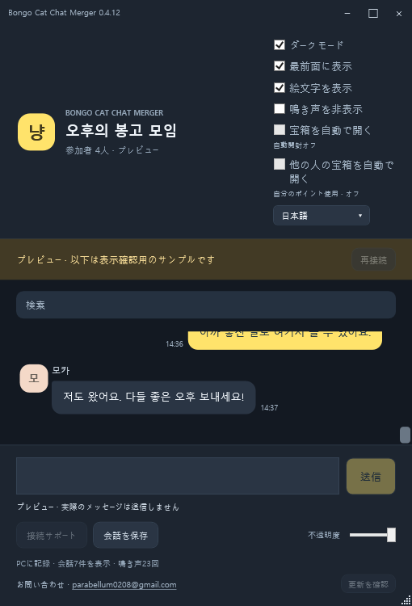

# Bongo Cat Chat Merger

**[Windows版をダウンロード](https://github.com/RATOY-Jeong/bongo-cat-chat-merger/releases/latest)** · **バージョン0.4.12**

[한국어](README.md) · [English](README.en.md) · **日本語**

Steam Bongo Catの同じ部屋の会話をまとめるWindows用チャットアプリです。別ウィンドウで会話を読み、そのまま送信できます。

## はじめに

1. 上のリンクから **BongoCatChatMerger-0.4.12.exe** をダウンロードして実行します。
2. 初回に言語を選択します。ゲームの場所と接続ファイルは自動で準備します。
3. 案内が出たら **セットアップしてゲームを再起動** を押します。ゲームフォルダーへの書き込みに必要な場合はWindowsの権限確認が表示されます。
4. Bongo Catで好きな部屋に入ると、チャットが接続されます。

次回からはデスクトップまたはスタートメニューのショートカットで起動できます。ZIPの展開や別のインストールスクリプトは不要です。ソースとruntimeを含む完全版ZIPもReleasesにあります。

**動作環境:** Windows 10/11 x64、.NET Framework 4.5以上、SteamとBongo Cat。ペン・タッチ互換設定は.NET Framework 4.7以上で適用されます。

## 主な機能

- 部屋の会話の受信と直接送信（Enterで送信、Shift+Enterで改行）
- ゲームの絵文字画像、全文一致の鳴き声の非表示・回数集計
- ダークモード、最前面表示、透明度、テキスト選択・コピー
- 名前・本文の検索と保存（通常の会話500件と鳴き声グループ）
- 韓国語・英語・日本語の切り替えと設定保存
- 接続の自動準備・修復、再接続、診断情報のコピー
- 自分の宝箱と他の人の宝箱の自動開封を個別に選択

宝箱機能の初期値はオフです。**他の人の宝箱を開くと自分のゲーム内ポイントを使います。** ゲーム内で相手の宝箱を直接クリックする場合と同じ動作です。[自分の宝箱](docs/AUTO-CHESTS.md) · [他の人の宝箱](docs/OTHER-CHESTS.md)

## 更新と接続

起動時に1回、または **更新を確認** を押したときにGitHubの正式版を確認します。新しい版があればダウンロードページを案内します。旧アプリを終了して新EXEを実行してください。[更新の仕組み](docs/UPDATES.md)

0.4.12はゲーム更新後の入室エラーを修正しました。ブリッジ0.2.5とJson.NET 13.0.2を内蔵しています。接続を停止していた場合は接続復元とゲーム再起動、更新案内が出た場合はセットアップとゲーム再起動を行ってください。[修正内容](docs/RUNTIME-0.4.12.md)

接続をやり直すには **再接続** を押します。ゲームだけの状態と比べるには、接続サポートを右クリックして接続機能の無効化とゲーム再起動を選びます。[ペンタブレット](docs/TABLET-COMPATIBILITY.md)

## 記録と設定

アプリ・設定・診断ログは `%LOCALAPPDATA%\BongoCatChatMerger`、部屋の会話はゲーム内の `BepInEx\BongoChat\room_<部屋ID>.jsonl` に保存します。自分の送信記録はアプリ内の `own-sends` に分け、受信・待機・拒否の状態を表示します。

記録には部屋ID、Steam ID、名前、本文、時刻が含まれます。インストール後に受信した会話から記録し、原本はディスクに残します。チャットウィンドウを閉じてもゲームのブリッジが動いている間は記録を続けます。別のチャットサーバーは使いません。

## ソースと構成

- [動作原理とビルド手順](docs/ARCHITECTURE.md#日本語)
- [配布133ファイル・内蔵39ファイルのSHA-256](docs/RELEASE-FILES-0.4.12.json)
- [ソース](src) · [ビルド・インストール・削除](scripts) · [テスト記録](docs/VALIDATION.md)
- [外部コンポーネントとライセンス](licenses/THIRD-PARTY-NOTICES.md)

ブリッジを削除するにはゲームを閉じ、完全版ZIPの `Uninstall.cmd` を実行してください。会話記録と外部で変更したファイルは保持します。

連絡先: [parabellum0208@gmail.com](mailto:parabellum0208@gmail.com)
