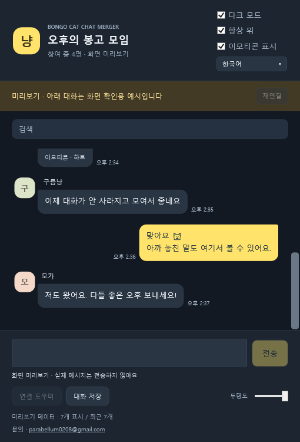

# Bongo Cat Chat Merger

**0.4.3:** 보낸 글을 다음 초안과 즉시 분리하고 실패·결과 불명 원문은 수동 복원할 수 있습니다. 게임에 빈 고양이가 생기면 **연결 도우미 우클릭 → 연결 기능 끄고 게임 재시작**으로 연결 구성을 끈 상태와 비교하고 **연결 복원하고 게임 재시작**으로 되돌리세요. 빈 고양이 원인과 휴이온 실기 해결은 아직 미확인입니다. [절차와 한계](docs/RELIABILITY-0.4.3.md).

[English](README.md) · **한국어** · [日本語](README.ja.md)

Steam 봉고캣의 같은 방 대화를 한곳에 모아 보여주는 Windows 보조 앱입니다. 직접 채팅, 게임 이모티콘 그림, 로컬 기록·검색, 한·영·일 UI를 지원합니다.

## 다운로드와 실행 — 0.4.3

**[BongoCatChatMerger-0.4.3.exe 받기](https://github.com/RATOY-Jeong/bongo-cat-chat-merger/releases/download/v0.4.3/BongoCatChatMerger-0.4.3.exe)** → **실행**하면 됩니다.

이 실행파일 하나에 연결에 필요한 파일이 모두 들어 있습니다. **압축 해제·게임 폴더 찾기·Install.cmd 실행은 필요 없습니다.**

1. EXE를 실행하고 처음 한 번 언어를 선택합니다.
2. 앱이 봉고캣 위치와 연결 파일을 자동으로 준비합니다. 재시작이 필요하면 **설치하고 게임 재시작**을 누르세요. Windows 권한 창이 뜨면 필요한 파일을 설치할 수 있도록 허용합니다.
3. 봉고캣이 자동으로 켜지면 **원하는 방에 입장**합니다. 봉고챗은 자동으로 연결됩니다.

다음부터는 바탕화면 또는 시작 메뉴의 **Bongo Cat Chat Merger** 바로가기를 실행하세요. Windows 10/11 64비트, .NET Framework 4.5 이상이 필요합니다. Steam과 봉고캣은 설치되어 있어야 합니다. [Releases](https://github.com/RATOY-Jeong/bongo-cat-chat-merger/releases/latest)의 ZIP은 선택 사항인 전체/개발용 패키지이며, Source code ZIP은 실행용 앱이 아닙니다.

## 자동으로 처리하는 작업

- Steam의 다른 라이브러리와 사용자 지정 설치 폴더까지 찾아 연결 파일을 확인합니다.
- 빠진 파일을 설치하고 중단된 설치를 복구합니다. 정상 설치가 있으면 그대로 사용합니다.
- 재시작 버튼은 게임에 정상 종료를 요청하고 준비 후 다시 켭니다. 게임을 강제로 종료하지 않으며, 종료되지 않으면 게임 트레이에서 종료하는 방법을 안내합니다.
- 게임 폴더에 쓰기 권한이 없을 때만 Windows 관리자 권한을 요청합니다. Windows의 허용 창과 게임 방 선택은 사용자가 직접 처리해야 합니다.
- 게임 원본 EXE·관리 DLL, 대화 기록, 호환되는 사용자 설정을 보존합니다. 알 수 없는 다른 모드나 외부에서 변경된 파일은 덮어쓰지 않고 이유를 안내합니다.
- **연결 도우미**로 자동 확인을 다시 실행합니다. 우클릭하면 게임 위치 직접 선택·진단 내용 복사가 있습니다.
- 파일 설치 완료와 실제 연결을 구분합니다. 게임에서 새 상태 신호를 받아야 ‘연결됨’으로 표시합니다.

## 업데이트와 설정

기존 봉고챗을 닫고 새 EXE를 실행하세요. **업데이트는 수동**이며 서버에서 새 프로그램을 자동으로 내려받거나 실행하지 않습니다.

앱은 **시작 시 한 번**, 그리고 **업데이트 확인** 버튼을 눌렀을 때만 GitHub의 정식 버전을 조회합니다. 실행 중 주기적으로 확인하지 않습니다. 새 EXE가 공개되면 **최신 업데이트가 있습니다!**와 **다운로드 페이지** 버튼을 표시합니다. 버튼은 브라우저의 해당 릴리스 페이지를 열며 파일 다운로드·설치는 사용자가 직접 합니다. 임시 저장·테스트 버전은 알리지 않습니다. 인터넷 오류나 조회 제한이 있어도 채팅은 계속 사용할 수 있습니다. [업데이트 확인 안내](docs/UPDATES.md).

앱 본체·설정·진단 로그는 <code>%LOCALAPPDATA%\BongoCatChatMerger</code>에 보관합니다. 다운로드한 EXE 옆의 기존 설정은 이미 저장된 값을 덮어쓰지 않고 한 번 가져옵니다. 예전 EXE가 다른 폴더에 있었다면 언어·테마를 다시 선택할 수 있지만 게임 폴더의 대화 기록은 유지됩니다.

검증된 연결 플러그인 **0.2.2**와 통신 형식은 그대로입니다. 정상 설치는 재설치하지 않습니다. 기존 소유권 목록으로 확인되는 설치만 복구하며 교체한 파일은 백업합니다.

## 채팅 기능

- 하단에서 직접 입력합니다. Enter 전송, Shift+Enter 줄바꿈이며 한글·일본어 조합 중에는 확정을 우선합니다. 게임의 기존 필터와 전송 기능을 사용합니다.
- 게임 이모티콘 그림 표시·숨김, 다크·라이트, 항상 위, 투명도, 메시지·닉네임 검색, 현재 방의 최근 500개 대화 저장을 지원합니다.
- 상단 드롭다운에서 English / 한국어 / 日本語를 바꿉니다. 실제 메시지·닉네임·방 이름·게임의 이모티콘 이름은 원문을 유지합니다.
- 언어를 바꿔도 초안과 전송 대기는 유지합니다. 재연결은 불확실한 요청을 취소하며 자동 재전송하지 않습니다.

## 펜 타블렛 호환성 — 0.4.3

다른 창에서 타블렛을 사용하는 중 봉고챗이 멈춘다는 보고에 대응해, 첫 창을 만들기 전에 봉고챗 안의 WPF 펜·터치 전용 처리를 끄도록 했습니다. 봉고챗은 일반 마우스·문자 입력을 사용하며 필압·잉크·터치 제스처 기능은 사용하지 않습니다. 다른 앱이나 타블렛 드라이버의 Windows Ink 설정은 바꾸지 않습니다.

WPF의 알려진 펜 처리 멈춤 경로를 완화하는 수정이며, 모든 휴이온 증상의 원인이 확정된 것은 아닙니다. 이 처리는 .NET Framework 4.7 이상에서 지원합니다. 더 오래된 환경에서도 앱은 실행하지만 완화 처리가 적용되지 않을 수 있습니다. 기존 봉고챗을 완전히 닫고 새 EXE를 실행한 뒤, 평소 그림 앱에서 펜을 사용해 보세요. **휴이온 실물 장비에서의 증상 해소는 아직 확인 전입니다.** [설명과 확인 순서](docs/TABLET-COMPATIBILITY.md).

## 기록과 개인정보

상대방은 설치하지 않아도 됩니다. 설치 후 실제 수신한 대화만 기록하며 과거 서버 대화는 복원하지 않습니다. 앱을 닫아도 게임이 켜져 있으면 플러그인이 계속 기록합니다.

기록은 게임 폴더의 <code>BepInEx\BongoChat\room_&lt;방 ID&gt;.jsonl</code>에 남습니다. 앱은 최근 최대 2MB에서 500개를 표시하고 원본은 보존합니다. 기록에는 방 ID·Steam ID·이름·내용·시각이 포함되니 공유 전 확인하세요. 이모티콘 캐시와 로컬 전송 요청도 같은 BongoChat 폴더에 보관합니다. 별도 서버로 대화를 업로드하거나 백신 예외·Windows 보안 설정을 변경하지 않습니다.

게임 업데이트 후에도 관련 내부 API가 호환되면 사용할 수 있습니다. 내부 구조가 바뀌면 앱이나 플러그인 수정이 필요할 수 있습니다.

## 소스·검증·제거

전체 ZIP에는 runtime·소스·스크립트·라이선스·문서가 있습니다. Windows PowerShell에서 <code>./scripts/Build.ps1</code>로 빌드합니다. <code>-GamePath</code>는 게임 경로, <code>-BridgeBinary</code>는 이미 검증된 플러그인 파일을 지정합니다. 빌드 후 <code>./scripts/Check.ps1</code>로 검사할 수 있습니다. 게임 원본 어셈블리는 재배포하지 않습니다.

0.4.3 검사는 설치/복구 63 + 기능·언어·재연결 58 + 펜 호환 11 + 신뢰성 37 + 업데이트 31 = **총 200개**입니다.

게임 플러그인을 제거하려면 봉고캣을 닫고 전체 ZIP의 <code>Uninstall.cmd</code>를 실행합니다. 대화 기록과 외부에서 변경된 파일은 보존합니다. 앱은 시스템 서비스 대신 사용자별 폴더와 바로가기를 사용합니다.

비공식 보조 앱입니다. [외부 구성요소·라이선스](licenses/THIRD-PARTY-NOTICES.md). 문의·버그 제보: [parabellum0208@gmail.com](mailto:parabellum0208@gmail.com).

Windows 10 대응을 위해 x64 빌드·Windows 10/11 실행 매니페스트·.NET Framework 4.5 기준을 명시하고, Windows 11 전용 제목 표시줄 처리는 Windows 10에서 건너뜁니다. 검사는 Windows 11(빌드 26300)에서 수행했으며 실제 Windows 10 PC 실행은 아직 확인하지 못했습니다.
