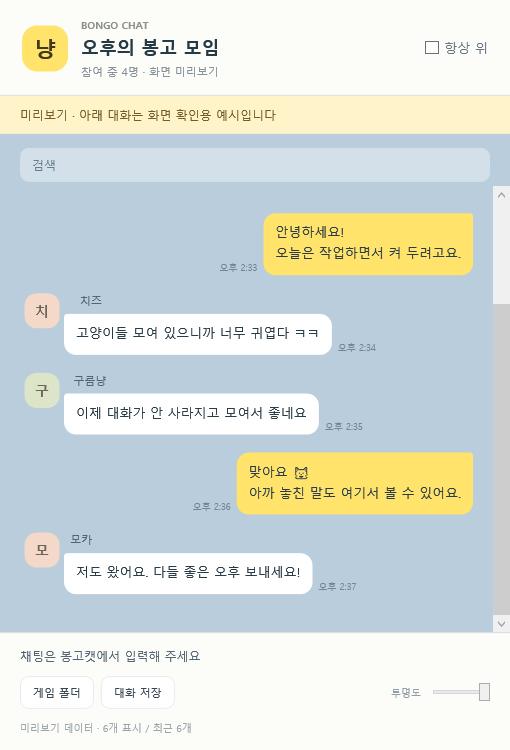

# Bongo Chat

Steam **Bongo Cat** 방 대화를 카카오톡처럼 말풍선으로 모아 보여주는 Windows 보조 앱입니다. **C# / WPF**, BepInEx 기반 수신 플러그인으로 만들었습니다.

## 다운로드와 실행

**[최신 테스트 버전 다운로드](https://github.com/RATOY-Jeong/bongo-chat/releases/latest)**에서 `BongoChat-0.1.zip`을 받으세요. GitHub의 `Source code` ZIP은 실행용 패키지가 아닙니다.

1. ZIP을 압축 해제하고 봉고캣을 완전히 종료합니다.
2. `Install.cmd`를 실행합니다. 게임 폴더를 자동으로 찾으며, 필요하면 `BongoCat.exe`를 선택합니다.
3. Steam에서 봉고캣을 다시 켜고 방에 들어갑니다.
4. `BongoChat.exe`를 실행합니다. 채팅 입력은 기존 봉고캣에서 합니다.

상대방은 설치하지 않아도 됩니다. 대화를 이 창으로 보고 싶은 사람만 설치하세요. 제거는 `Uninstall.cmd`를 실행합니다.

## 기능

- 내 메시지 / 상대 메시지 말풍선, 닉네임, 수신 시각
- 최근 500개 표시, 검색, 텍스트 저장
- 항상 위에 표시, 투명도·창 크기 조절
- 방 이동 시 대화 전환, 내 PC에 기록 보관

초기 테스트 버전입니다. Windows x64 및 Bongo Cat 빌드 25723683에서 플러그인 로드와 실제 방 메시지 기록을 확인했습니다. 기존 모드 로더가 있으면 자동 설치를 중단합니다. 설치 전 대화 복구와 이 창에서의 메시지 전송은 지원하지 않습니다.

## 소스와 빌드

`BongoChat.cs`: 채팅창 / `BridgePlugin.cs`: 수신 플러그인 / `Build.ps1`: 빌드

빌드하려면 실행용 ZIP의 `runtime` 폴더를 이 소스 폴더에 복사하고 Windows PowerShell에서 `./Build.ps1`을 실행하세요. 설치된 게임의 어셈블리를 참조하며 .NET Framework의 C# 컴파일러를 사용합니다. 결과는 `build` 폴더에 생성됩니다.

자세한 설치·기록 위치는 [사용 안내](USER-GUIDE.md), 검사 내용은 [VALIDATION.md](VALIDATION.md), 포함 구성요소는 [THIRD-PARTY-NOTICES.md](THIRD-PARTY-NOTICES.md)를 참고하세요. 이 프로젝트는 비공식 보조 앱입니다.
