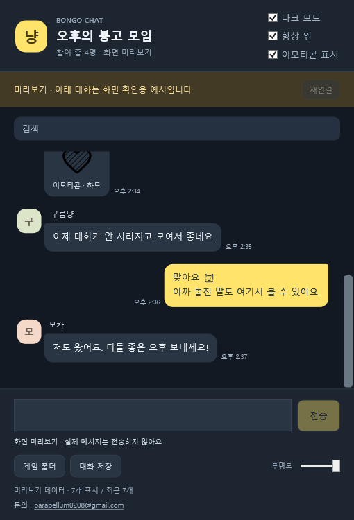

# Bongo Cat Chat Merger

## [⬇ Download for Windows — BongoCatChatMerger-0.4.5.exe](https://github.com/RATOY-Jeong/bongo-cat-chat-merger/releases/download/v0.4.5/BongoCatChatMerger-0.4.5.exe)

**Download the EXE and run it. No ZIP extraction is needed.**

**English** · [한국어](README.ko.md) · [日本語](README.ja.md)

**0.4.5:** Optional **Hide meows** toggle directly below **Show emotes**. Only exact localized meow phrases are hidden; longer messages mentioning them remain visible. Off by default; your choice is saved. [Details and supported phrases](docs/MEOW-FILTER.md). Drag selection / Ctrl+C copying is retained.

A lightweight Windows companion for your Steam Bongo Cat room: live chat, direct sending, original emote images, local history/search, and English/Korean/Japanese UI.

## Download and start — 0.4.5

**[Download BongoCatChatMerger-0.4.5.exe](https://github.com/RATOY-Jeong/bongo-cat-chat-merger/releases/download/v0.4.5/BongoCatChatMerger-0.4.5.exe)** and run it. This single file includes everything required for connection setup. You do not need to extract a ZIP, find a game folder, or run Install.cmd.

1. Run the EXE and choose your language on first launch.
2. The app finds Bongo Cat and prepares the connection automatically. If the game must restart, click **Set up & restart game**. If Windows requests permission, approve the prompt to allow the required game-folder files to be installed.
3. Bongo Cat opens automatically. **Join your preferred room**; the companion connects automatically.

A shortcut named **Bongo Cat Chat Merger** is created on the desktop and in the Start menu. Windows 10/11 x64 with .NET Framework 4.5+ is required. Steam and Bongo Cat must already be installed. The ZIP in [Releases](https://github.com/RATOY-Jeong/bongo-cat-chat-merger/releases/latest) is an optional full/developer package; the generated Source code archives are not the standalone app.

## Automatic connection setup

- Detects Steam libraries and custom game install folder names, and checks the connection files.
- Installs missing files and repairs an incomplete installation. Existing compatible installations are reused.
- The restart button requests a normal game exit and opens it again after setup. The app never forcibly kills the game. If normal exit fails, it explains how to exit from the game tray menu.
- Requests administrator permission only if the game folder denies ordinary writes. Windows permission prompts and choosing a game room remain user actions.
- Preserves original game EXE/managed assemblies, conversations, and compatible user configuration. Unknown mod loaders or externally modified installation files are preserved and reported.
- **Connection helper** retries detection/setup. Right-click it for manual game selection or diagnostics.
- A successful file installation is distinguished from an actual connection: the app waits for the game's fresh heartbeat before showing Connected.

## Updating and settings

Close your old companion, then run the new EXE. Updates are **manual**. The app does not download or execute updates from a server.

The app checks public GitHub full-release metadata **once when it starts** and when you click **Check updates**. It does not run periodic update checks. A ready newer EXE shows **A new update is available!** and a **Download page** button. The button opens that release in your browser; the app never downloads or installs the file itself. Drafts and prereleases are excluded. Offline and rate-limit errors do not interrupt chat. [Update check details](docs/UPDATES.md).

The app stores its managed copy, settings, and diagnostic logs under <code>%LOCALAPPDATA%\BongoCatChatMerger</code>. Existing preferences beside the downloaded EXE are imported once without replacing choices already stored there. If your old EXE is in another folder, language/theme may need to be selected again; game conversation records stay in the game folder.

The verified bridge **0.2.2** binary and its protocol are unchanged. An installed compatible bridge does not need to be reinstalled. If an older owned installation needs repair, the helper checks its ownership manifest and keeps backups of replaced files.

## Chat features

- Send from the bottom input: Enter sends; Shift+Enter adds a line. IME composition is completed before sending. The game's existing chat filter and send function are used.
- Show/hide original emote images, dark/light mode, always-on-top, opacity, name/message search, and export of the current room's most recent 500 messages.
- Select English / 한국어 / 日本語 from the dropdown. Messages, player/room names and game emote names keep their original text.
- Changing language keeps drafts and pending requests. Reconnecting cancels uncertain requests without replaying them.

## Pen tablet compatibility — 0.4.5

For reports of the chat window freezing while a pen tablet is used elsewhere, the app now requests WPF's process-local stylus/touch opt-out before the first window is created. Chat uses ordinary mouse/text input; raw pressure, ink and touch gestures are not used in this window. Other applications and the tablet driver's Windows Ink settings are not changed.

This mitigates a known class of WPF tablet-processing freezes; it does not establish the cause of every Huion report. The opt-out is supported by .NET Framework 4.7+. On an older runtime the app still starts, but the mitigation may be unavailable. Close the old companion before running the new EXE, then test normal pen use in your drawing app. **Huion hardware reproduction is still pending.** [Details and test steps](docs/TABLET-COMPATIBILITY.md).

## Records and privacy

Other players do not need this app. Only messages received after installation are recorded; earlier server history cannot be restored. The game bridge continues recording while the game runs, even if the companion is closed.

Records remain in <code>BepInEx\BongoChat\room_&lt;room ID&gt;.jsonl</code> under the game folder. The app reads the latest 2 MB and displays up to 500 messages; the full journal remains on disk. Records include room IDs, Steam IDs, names, content and timestamps. Emote caches and local send requests are in that same BongoChat folder. This app does not upload conversations to a separate server, add antivirus exclusions, or change Windows security settings.

Future game updates work only while the relevant internal APIs remain compatible. Structural changes can require a new app/bridge release.

## Source, verification and removal

The full ZIP includes <code>runtime</code>, source, scripts, licenses and docs. Build with <code>./scripts/Build.ps1</code> in Windows PowerShell; optional <code>-GamePath</code> selects a game installation. For release reproduction, <code>-BridgeBinary</code> reuses an already verified bridge. Run <code>./scripts/Check.ps1</code> after building. Original game assemblies are not redistributed.

0.4.5 passed **63 setup + 62 feature/language/reconnect + 11 tablet compatibility + 37 reliability + 31 update + 39 meow filter checks (243 total)**.

To remove the game bridge, close Bongo Cat and run <code>Uninstall.cmd</code> from the full ZIP. It preserves journals and modified files. The companion itself uses a per-user app folder and shortcuts rather than a system service.

This is an unofficial companion. See [third-party notices and licenses](licenses/THIRD-PARTY-NOTICES.md). Contact: [parabellum0208@gmail.com](mailto:parabellum0208@gmail.com).

Windows 10 compatibility is targeted through an explicit x64 build, Windows 10/11 application manifest and .NET Framework 4.5 baseline. Windows 11-only title-bar styling is skipped on Windows 10. Checks ran on Windows 11 (build 26300); execution on an actual Windows 10 PC has not yet been verified.
