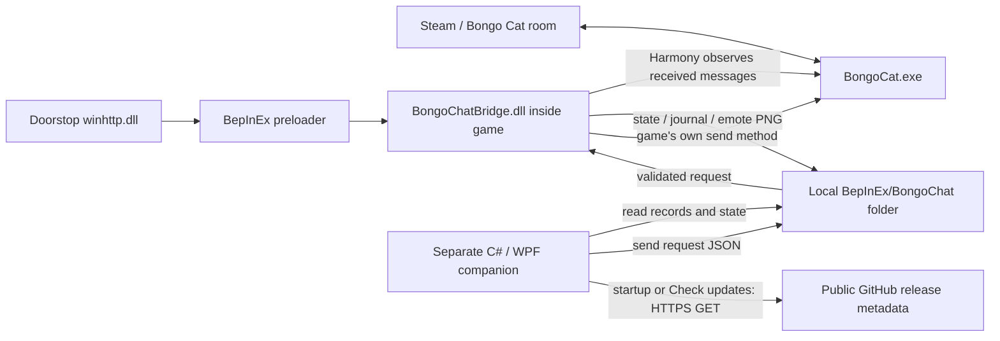

# Architecture and release review

[English](#english) · [한국어](#한국어) · [日本語](#日本語) · [File inventory](RELEASE-FILES-0.4.12.json)

## English

This is how **app 0.4.12 / bridge 0.2.5** connects to the game, what it installs, and how to build it. The release source is commit [`ee81f0513900e8872f5b7574c69632b32aa61317`](https://github.com/RATOY-Jeong/bongo-cat-chat-merger/tree/ee81f0513900e8872f5b7574c69632b32aa61317). This document was added on 2026-11-22; the original release files have not been replaced.

### Process and data flow



1. The downloaded EXE stages a copy of itself under the current user's `%LOCALAPPDATA%\BongoCatChatMerger` and creates desktop/Start menu shortcuts. It launches that copy and exits the original process. See [DesktopInstall.cs](../src/app/DesktopInstall.cs).
2. [SetupEngine.cs](../src/app/SetupEngine.cs) reads the embedded ZIP resource `BongoChat.SetupPayload`. It installs the bundled runtime and bridge into the selected game folder, tracks owned files in `BongoChat-install.json`, and preserves unknown or externally modified files. It does not download the connection runtime at installation time.
3. The game-local **`winhttp.dll` is the UnityDoorstop loader**, not a replacement for Windows' system DLL. It starts BepInEx, which loads the bridge in the game process. Doorstop changes Mono's library lookup to `BepInEx/unstripped`; the game's `BongoCat_Data/Managed` files stay in place. This changes the game's runtime environment even though original game files are not overwritten.
4. [BridgePlugin.cs](../src/bridge/BridgePlugin.cs) attaches Harmony prefixes to game methods. It observes room messages and appends chat/emote records locally. It also restores the Addressables catalog's legacy marker in memory after checking its header/version, and clears two inherited Doorstop startup guards in the current process. [JsonRuntimeCompatibility.cs](../src/bridge/JsonRuntimeCompatibility.cs) checks the bundled JSON library before declaring readiness. These are game-process changes, not merely screen scraping.
5. [Communication.cs](../src/app/Communication.cs) polls local files in the background. A fresh, ready bridge heartbeat is required for an active connection. The UI displays retained local events; it does not connect a second account to the room.
6. For direct sending, the UI writes a request containing its request ID, room, session and text. [BridgeFeatures.cs](../src/bridge/BridgeFeatures.cs) validates it, calls the main cat's existing `Vfx.CatSpeech.SendSpeech`, observes whether the native multiplayer send path ran, and writes a result. A local result/receipt is not independent proof that every room member received the message. The game's filters are not bypassed.
7. Emote IDs are observed from the room; [SpriteExporter.cs](../src/bridge/SpriteExporter.cs) converts the game's loaded sprite into a local PNG cache. Game art is not shipped as a separate asset collection in this repository.

### What is public, and where

| Location | Contents / review entry points |
|---|---|
| [`src/app`](../src/app) | C# WPF UI, localization, history, input, installation, update metadata, diagnostics |
| [`src/bridge`](../src/bridge) | Game-process bridge, runtime hooks, emote export, chest adapters, JSON checks |
| [`src/shared`](../src/shared) | Request validation and chest lease/protocol policy |
| [`scripts`](../scripts) | Build, fixture checks, game discovery, installation and removal |
| [`tests`](../tests) | Isolated fixtures and regression checks; not a malware audit |
| [`licenses`](../licenses) | Bundled third-party license texts and upstream provenance |
| [`doorstop_config.ini`](doorstop_config.ini), [`BepInEx.cfg`](BepInEx.cfg) | Exact shipped Doorstop and BepInEx configuration, published for review |
| [`RELEASE-FILES-0.4.12.json`](RELEASE-FILES-0.4.12.json) | All **133 files** in the original full ZIP, with sizes, SHA-256 and component grouping; all **39** embedded setup entries and their hashes |

Runtime binaries and build output are intentionally ignored by Git. They are available in the **full release ZIP** and the EXE's embedded setup resource, rather than in the GitHub source-only archive. The source-only archive therefore cannot build the complete installer without the runtime. The proprietary game, original game assemblies, player chat records, settings and credentials are not published. Upstream libraries' source is maintained by their respective projects; this repository does not claim to author those DLLs.

### Bundled third-party components

| Bundle / component | Source and version | Role |
|---|---|---|
| BepInEx Windows x64 bundle | [v5.4.23.5](https://github.com/BepInEx/BepInEx/releases/tag/v5.4.23.5) | Mod bootstrap/runtime; includes the loader and Harmony/MonoMod/Cecil libraries |
| UnityDoorstop | [UnityDoorstop source](https://github.com/NeighTools/UnityDoorstop); exact binary supplied by the BepInEx bundle above | Game-local DLL loader and Mono search-path configuration |
| HarmonyX / MonoMod / Mono.Cecil | [HarmonyX](https://github.com/BepInEx/HarmonyX), [MonoMod](https://github.com/MonoMod/MonoMod), [Mono.Cecil](https://github.com/jbevain/cecil); exact bytes pinned by the inventory | Runtime patching and assembly support |
| Windows Mono class libraries | Unity **2022.3.30 Win** profile, linked in [BepInEx UnityDataMiner issue 3](https://github.com/BepInEx/UnityDataMiner/issues/3) | Full framework libraries in `BepInEx/unstripped` |
| Json.NET | [official Newtonsoft.Json 13.0.2 NuGet](https://www.nuget.org/packages/Newtonsoft.Json/13.0.2), `lib/net45/Newtonsoft.Json.dll` | Full JSON implementation compatible with the supplied Mono interfaces |

See [THIRD-PARTY-NOTICES.md](../licenses/THIRD-PARTY-NOTICES.md) for archive URLs, upstream archive hashes and license files. The inventory pins actual shipped files, including libraries whose individual upstream version is not separately asserted here. The unstripped profile comes from the linked upstream project's issue attachment; it is a distributed dependency, not generated from the game by this app. The Json.NET DLL SHA-256 is `c5c83bbc1741be6ff4c490c0aee34c162945423ec577c646538b2d21ce13199e`.

### Disk writes, permissions and persistence

| Location | What is stored |
|---|---|
| `%LOCALAPPDATA%\BongoCatChatMerger` | Version/hash-specific executable copy, preferences, diagnostic logs, current-app pointer, third-party notices |
| `...\own-sends` under that user folder | Local outgoing receipts, including rejected/unconfirmed text; up to 500 per game installation |
| Desktop / Start menu | `.lnk` shortcuts created via `WScript.Shell` COM |
| Game folder | `winhttp.dll`, `doorstop_config.ini`, runtime files, bridge and ownership manifest |
| Game `BepInEx\BongoChat` | `state.json`, `room_<room ID>.jsonl`, `emotes/*.png`, `commands` and result JSON, chest leases, installer backups |

The automatic setup code requests UAC elevation through a narrowly scoped helper command when ordinary game-folder writes are denied. Normal UI use does not request administrator privileges on every launch. Game discovery reads Steam installation information; the app does not register itself as a Windows service, scheduled task or startup app. A shortcut is not an automatic-start entry.

Room journals contain timestamps, room IDs, Steam IDs, display names and messages. The UI retains 500 ordinary events plus compacted meows, but the original journal on disk is not reduced to 500 events. **Closing the UI does not unload the bridge:** while the game continues running, recording continues. Locally stored files are not encrypted by this app and should be treated as private data.

### Network and optional automation

The companion's explicit network client is [UpdateService.cs](../src/app/UpdateService.cs). It requests public GitHub release metadata once on startup and on a manual check, at these endpoints:

- `https://api.github.com/repos/RATOY-Jeong/bongo-cat-chat-merger/releases?per_page=20`
- `https://api.github.com/repos/RATOY-Jeong/bongo-cat-chat-merger/releases/latest` (bounded fallback)

It sends a versioned User-Agent and normal HTTP request metadata, without a GitHub token, chat text or chat journal. GitHub/network intermediaries can see ordinary connection information such as the source IP. The download button opens the public repository in the user's browser. There is no automatic update binary download or execution in this version. The browser, Steam, game and bundled upstream runtimes have their own behavior; this description of the companion's explicit client is not a network audit of every dependency.

[Own chest opening](AUTO-CHESTS.md) and [other-member chest opening](OTHER-CHESTS.md) are separate, saved opt-ins, off by default. The bridge uses existing game controls under a current session/room lease. **Opening other people's chests spends the user's own game points.** These adapters and their permission policy are public in `BridgeAutoChests.cs`, `BridgeOtherChests.cs` and `src/shared/AutoChestProtocol.cs`. They are not required to read chat.

### Build from source and verify files

Use Windows PowerShell, the Windows x64 .NET Framework compiler/WPF assemblies, an installed Steam Bongo Cat, and the runtime from the full ZIP. Game assembly references are resolved from the user's own game installation. Close the game when replacing its connection files.

1. Obtain the source at tag `v0.4.12` (or the exact commit above). Obtain the matching **full** release ZIP and check its SHA-256.
2. Copy the ZIP's `runtime` directory into the source root, next to `src`, `scripts` and `licenses`.
3. To compile **both our bridge and UI from source**, run:

```powershell
.\scripts\Build.ps1 -GamePath 'D:\SteamLibrary\steamapps\common\Bongo Cat'
.\scripts\Check.ps1
```

Adjust the game path. `Build.ps1` references the installed game and bundled dependencies, compiles the bridge, ZIPs the runtime plus compiled bridge, then embeds that ZIP and third-party notices into the WPF EXE. It does not fetch dependencies from the Internet.

The optional `-BridgeBinary <path>` mode **reuses a supplied precompiled bridge**; it recompiles only the UI and embeds the supplied bridge/runtime. To review the bridge by building it yourself, leave that option out. Compiler/assembly versions, timestamps and ZIP metadata can change the output hash; this build script does not currently produce a bit-for-bit reproducible release.

For the original downloaded artifacts:

```powershell
Get-FileHash .\BongoCatChatMerger-0.4.12.exe -Algorithm SHA256
Get-FileHash .\BongoCatChatMerger-0.4.12.zip -Algorithm SHA256
```

| Original artifact | SHA-256 |
|---|---|
| EXE | `b6728088f1184288598e72b523fcbe27f7747ae980d6cc368706e8e40224d50f` |
| Full ZIP | `21206291214f91fb79a227537399ac7bfe79589428a812f1476c738dc70e45f5` |

On 2026-11-22, the local EXE's embedded `BongoChat.SetupPayload` was read without running the app: all 39 entries matched the corresponding original full ZIP files. All ZIP source/scripts/tests/runtime files also matched the release working copy. The inventory covers the **original** release, not documentation added later. SHA-256 is used here to check that the files match. Version 0.4.12's EXE is **not Authenticode-signed**.

### Antivirus reports and review limits

The [VirusTotal report for the original EXE](https://www.virustotal.com/gui/file/b6728088f1184288598e72b523fcbe27f7747ae980d6cc368706e8e40224d50f/detection), observed 2026-11-22, showed **4/71** detections: Bkav Pro `W32.Malware.4A9DCA7B`, Cynet `Malicious (score: 100)`, SecureAge `Malicious`, Trapmine `Malicious.moderate.ml.score`. Results can change after that observation.

The unsigned EXE, bundled loader and game runtime hooks may be involved, but the vendors have not confirmed the cause. The detections remain unresolved. This app does not add antivirus exclusions or change Windows security settings. An independent security review of the app and its dependencies has not yet been completed.

### Disable / remove

To isolate a game issue, the connection helper's context menu offers **Disable connection & restart game**. The owned game-local loader is renamed to `winhttp.dll.bongochat-paused`; reconnecting alone does not override the paused state. This is reversible and preserves game data and conversation records.

To uninstall the bridge, close the game and run `Uninstall.cmd` from the full ZIP, or inspect/run [Uninstall-Bridge.ps1](../scripts/Uninstall-Bridge.ps1). It removes only manifest-owned files whose hashes still match and preserves externally changed files and journals. The per-user companion folder, shortcuts and chat records are separate from bridge removal; close the app before manually removing them. Deleting the chat journals permanently deletes that local history, so export or back them up first.

## 한국어

이 문서는 **앱 0.4.12 / 플러그인 0.2.5**의 공개 검토 안내입니다. 위 영어 본문에 파일별 역할·구조·빌드 순서를 자세히 적었습니다.

- **직접 작성한 소스:** `src/app`(C#/WPF 창), `src/bridge`(게임 안에서 실행되는 연결 플러그인), `src/shared`(통신·옵션 검증). 빌드·설치·제거 스크립트와 테스트도 공개돼 있습니다.
- **연결 원리:** 게임 폴더의 Doorstop `winhttp.dll` → BepInEx → 플러그인 순서로 로드됩니다. Harmony로 게임 내부 메서드를 관찰하고, 로컬 JSON 파일을 통해 별도 채팅창과 통신합니다. 단순히 화면을 읽는 방식이 아니라 게임 프로세스의 실행 환경을 바꿉니다. 게임 원본 Managed 파일을 덮어쓰지는 않습니다.
- **직접 전송:** 요청 JSON을 검증한 뒤 게임 자체 전송 함수와 필터를 사용합니다. 로컬 전송 결과만으로 모든 상대방에게 도착했다고 보증하지 않습니다.
- **외부 DLL:** BepInEx 5.4.23.5 묶음, 그 안의 Doorstop/HarmonyX/MonoMod/Cecil, Unity 2022.3.30 Windows용 Mono 라이브러리, 공식 Json.NET 13.0.2를 포함합니다. [출처·라이선스](../licenses/THIRD-PARTY-NOTICES.md)와 [전체 파일·해시](RELEASE-FILES-0.4.12.json)로 검토할 수 있습니다. 외부 라이브러리의 소스는 각 원저작자 저장소에 있습니다.
- **파일 공개 범위:** 원래 ZIP의 133개 파일과 EXE 내장 연결 파일 39개의 크기·SHA-256을 목록화했습니다. 내장 파일이 ZIP의 대응 파일과 모두 일치함을 확인했습니다. [Doorstop 설정](doorstop_config.ini)과 [BepInEx 설정](BepInEx.cfg)도 별도로 공개했습니다. 실행 DLL은 소스 저장소 대신 전체 배포 ZIP에 들어 있습니다. 게임 원본·사용자 대화·개인 설정은 공개하지 않습니다.
- **기록·설치 위치:** 앱은 `%LOCALAPPDATA%\BongoCatChatMerger`, 게임 연결 파일과 대화는 게임의 `BepInEx\BongoChat` 등에 있습니다. 기록에는 Steam ID·방 ID·이름·대화·시각이 포함되고, 앱이 암호화하지 않습니다. 화면의 500개 제한과 달리 원본 기록은 계속 남습니다. 채팅창을 닫아도 게임과 플러그인이 켜져 있으면 기록은 계속됩니다.
- **권한·통신:** 게임 폴더 쓰기가 거부될 때만 설치용 관리자 권한을 요청합니다. 백신 예외나 Windows 보안 설정을 바꾸지 않습니다. 앱 시작/확인 버튼에서 GitHub의 공개 릴리스 정보를 조회하며 대화·토큰은 보내지 않습니다. 일반 접속 정보(IP 등)는 서버에 전달됩니다. 업데이트 EXE 자동 다운로드·실행은 없습니다. 여기서는 머지어 코드의 통신을 설명하며, Steam·게임·외부 라이브러리의 통신은 별도 검토 대상입니다.
- **상자 기능:** 내 상자와 다른 사람 상자는 별도 선택 기능이며 기본 꺼짐입니다. 다른 사람 상자를 열면 **내 게임 포인트를 사용**합니다.
- **직접 빌드:** 같은 버전의 소스와 전체 ZIP의 `runtime`, 본인 PC의 게임이 필요합니다. 위 명령으로 플러그인과 앱을 모두 컴파일할 수 있습니다. `-BridgeBinary`는 기존 DLL을 재사용하는 옵션입니다. 플러그인도 직접 컴파일하려면 이 옵션을 빼고 빌드하세요. 컴파일러와 ZIP 생성 시각 등에 따라 결과 해시는 달라질 수 있습니다.
- **현재 확인할 점:** 0.4.12는 코드 서명이 없습니다. 2026-11-22 VirusTotal에서 4/71 탐지를 확인했습니다. 로더나 런타임 패치 구조가 관련됐을 수 있으나 업체에서 원인을 확인해 준 상태는 아닙니다. 외부 보안 검토는 아직 받지 않았습니다. SHA-256은 배포 파일이 같은 파일인지 확인하는 데 사용합니다.
- **중단·제거:** 연결 도우미 우클릭의 연결 끄기/게임 재시작은 로더를 비활성 이름으로 바꿉니다. 완전 제거는 게임을 닫고 전체 ZIP의 `Uninstall.cmd`를 사용하며, 소유권·해시가 확인되는 파일만 지웁니다. 앱 폴더·바로가기·대화 기록은 별도입니다.

## 日本語

**アプリ0.4.12 / ブリッジ0.2.5**の公開レビュー用資料です。詳細な構造、ソースへのリンク、ビルド手順は上の英語本文にあります。

- 自作コードは `src/app`、`src/bridge`、`src/shared` にあり、ビルド・インストール・削除スクリプトとテストも公開しています。
- ゲーム内のDoorstop/BepInExがブリッジを読み込み、Harmonyによるゲーム内メソッドの監視とローカルJSONファイルで通信します。画面の読み取りだけではなく、ゲームの実行環境を変更します。元のManagedファイルは上書きしません。
- 外部DLLはソース用アーカイブではなく完全版ZIPに含まれます。[配布ファイル133件・内蔵ファイル39件のSHA-256一覧](RELEASE-FILES-0.4.12.json)、[Doorstop設定](doorstop_config.ini)・[BepInEx設定](BepInEx.cfg)、[依存関係の出典とライセンス](../licenses/THIRD-PARTY-NOTICES.md)を公開しています。
- 会話にはSteam ID・部屋ID・名前・本文・時刻が含まれ、ローカルに暗号化せず保存します。UIを閉じてもゲームが動いていれば記録は続きます。
- 起動時または更新確認ボタンで公開GitHubメタデータを取得します。会話やトークンは送らず、更新EXEの自動取得・実行も行いません。通常の接続情報はサーバーに伝わります。
- 他人の箱を開く機能は別の初期OFF設定で、**自分のゲーム内ポイントを消費**します。
- 完全なソースビルドには同じ版のruntimeと自分のゲームが必要です。`-BridgeBinary`は既存DLLの再利用であり、ブリッジを再コンパイルしません。バイト単位の再現性は保証しません。
- 0.4.12は未署名です。2026-11-22のVirusTotal表示は4/71で、検知原因はベンダーに未確認です。外部のセキュリティレビューはまだ受けていません。SHA-256は配布ファイルの一致確認に使用します。
