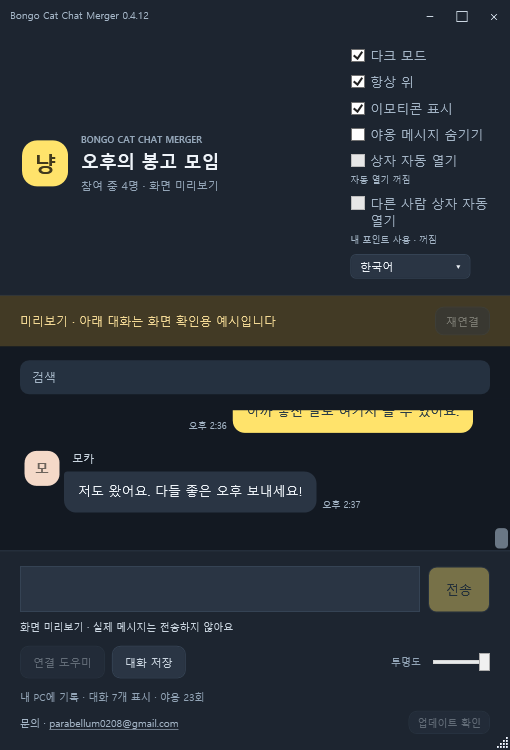

# Bongo Cat Chat Merger

**[Windows용 다운로드](https://github.com/RATOY-Jeong/bongo-cat-chat-merger/releases/latest)** · **버전 0.4.12**

[한국어](../README.md) · [English](../README.en.md) · [日本語](../README.ja.md)

Steam 봉고캣의 같은 방 대화를 모아 보여주는 Windows 채팅 앱입니다. 게임 화면을 오가지 않고 채팅을 읽고 보낼 수 있습니다.

## 시작하기

1. 위 다운로드 페이지에서 **BongoCatChatMerger-0.4.12.exe**를 받아 실행합니다.
2. 처음 한 번 언어를 선택합니다. 앱이 게임 위치와 연결 파일을 자동으로 준비합니다.
3. 안내가 뜨면 **설치하고 게임 재시작**을 누릅니다. 게임 폴더에 쓰기 권한이 필요할 때 Windows 권한 창이 뜹니다.
4. 봉고캣에서 원하는 방에 입장하면 채팅창이 연결됩니다.

다음부터는 바탕화면이나 시작 메뉴의 **Bongo Cat Chat Merger** 바로가기로 실행하세요. 압축 해제나 별도의 설치 스크립트 실행은 필요 없습니다. 전체 소스와 연결 파일이 필요한 경우 Releases의 ZIP을 받으면 됩니다.

**실행 환경:** Windows 10/11 64비트, .NET Framework 4.5 이상, Steam과 봉고캣. 펜·터치 처리 호환 설정은 .NET Framework 4.7 이상에서 적용됩니다.

## 주요 기능

- 같은 방의 채팅 수신과 직접 전송 — Enter 전송, Shift+Enter 줄바꿈
- 게임 이모티콘 그림 표시·숨김, 정확히 일치하는 야옹 메시지 숨김·횟수 묶음
- 다크모드, 항상 위, 창 투명도, 텍스트 선택·복사
- 대화·닉네임 검색과 저장 — 최근 일반 대화 500개와 별도 야옹 묶음
- 한국어·영어·일본어 선택과 설정 저장
- 연결 파일 자동 준비·복구, 재연결, 진단 내용 복사
- 내 상자 자동 열기와 다른 사람 상자 자동 열기 — 각각 별도 선택

상자 기능은 기본 꺼짐입니다. **다른 사람 상자 열기는 내 게임 포인트를 사용**하며, 게임에서 다른 사람의 상자를 직접 눌렀을 때와 같은 동작입니다. [내 상자 안내](AUTO-CHESTS.md) · [다른 사람 상자 안내](OTHER-CHESTS.md)

## 업데이트와 연결

앱 시작 시 한 번 또는 **업데이트 확인**을 눌렀을 때 GitHub의 정식 버전을 조회합니다. 새 버전이 있으면 다운로드 페이지를 안내합니다. 기존 앱을 닫고 새 EXE를 실행하면 됩니다. [업데이트 확인 방식](UPDATES.md)

0.4.12는 게임 업데이트 후 방 입장이 막히던 문제를 수정했습니다. 플러그인 0.2.5와 Json.NET 13.0.2가 EXE에 포함돼 있습니다. 연결을 꺼 둔 경우 **연결 복원하고 게임 재시작**, 교체 안내가 뜨면 **설치하고 게임 재시작**을 누르세요. [수정 내용](RUNTIME-0.4.12.md)

연결 문제가 생기면 **재연결**을 눌러 보세요. 게임 자체의 문제를 비교하려면 **연결 도우미 우클릭 → 연결 기능 끄고 게임 재시작**을 사용할 수 있습니다. [펜 타블렛 안내](TABLET-COMPATIBILITY.md)

## 기록과 설정

앱·설정·진단 로그는 `%LOCALAPPDATA%\BongoCatChatMerger`에, 방 대화는 게임 폴더의 `BepInEx\BongoChat\room_<방 ID>.jsonl`에 저장합니다. 내 전송 기록은 앱 폴더의 `own-sends`에 따로 보관하며 수신·대기·거절 상태를 표시합니다.

대화 기록에는 방 ID·Steam ID·이름·본문·시각이 들어갑니다. 설치 이후 받은 대화부터 기록하고 원본은 디스크에 유지합니다. 채팅창을 닫아도 게임의 연결 플러그인이 실행 중이면 기록은 계속됩니다. 별도 대화 서버는 사용하지 않습니다.

## 소스와 구성

- [작동 원리와 구조](ARCHITECTURE.md#한국어) — 연결 방식, 저장 위치, 외부 통신, 직접 빌드하는 방법
- [배포 파일 133개와 내장 파일 39개의 SHA-256](RELEASE-FILES-0.4.12.json)
- [소스](../src) · [빌드·설치·제거 스크립트](../scripts) · [검사 기록](VALIDATION.md)
- [외부 구성요소와 라이선스](../licenses/THIRD-PARTY-NOTICES.md)

게임 연결 플러그인은 게임을 닫고 전체 ZIP의 `Uninstall.cmd`로 제거할 수 있습니다. 대화 기록과 외부에서 수정한 파일은 보존합니다.

문의·버그 제보: [parabellum0208@gmail.com](mailto:parabellum0208@gmail.com)
